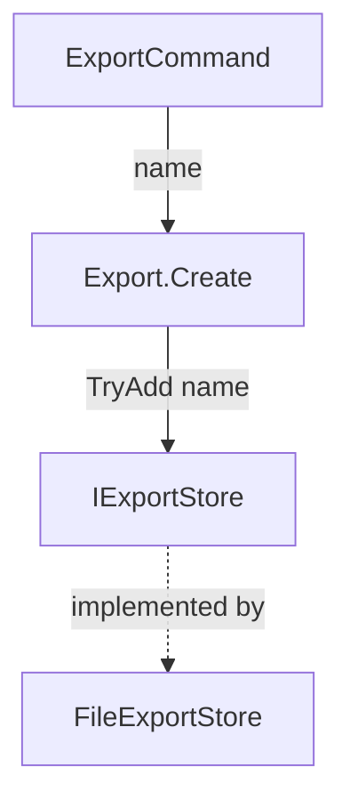

# Reporting to a Person

Load before writing a blocker, a decision card, a Spec delta, a briefing, or a run report. The decide-or-ask rule and the question form: `copilot-instructions.md` Section 4.16.

Human review capacity limits throughput. Write every human-facing text so a person can judge it in the shortest time without asking back.

## Reader-first rules

- ❗ Separate readers. Plans and review findings are agent handoffs: detail stays. A person gets a Spec delta, a decision card, or a briefing.
- Lead with the verdict. Rank by risk. Stop when the reader can decide.
- Show evidence, not narrative: the command, what was observed, a link.
- Never restate what a link or the diff already shows. Never copy between artifacts; link.
- Every item stands alone: the reader may not have seen earlier output.
- Mark where human attention pays off:

| Mark | Meaning | Examples |
|------|---------|----------|
| **Judge** | A person must decide whether it is right | Security, public API, data format, migration, limit, dependency, architecture break |
| **Sample** | Read part of it; tests cover the logic | Non-trivial logic, a new type with behavior |
| **Routine** | Mechanical; the machine checked it | Renames, usings, wiring, docs that passed the Sync check |

- ❗ A mark rates attention, never success. Write it as the word. Never use red, yellow, or green symbols for it: a reader takes red for a failure. Success and failure use the Section 5 legend only.

| Artifact | Budget |
|----------|--------|
| Spec delta | One screen per 10 requirements |
| Decision card | 25 lines |
| Briefing | Head and Concept one screen each; a card of at most 15 lines per Judge or Sample file |
| Run report | Only what is open; `none` otherwise |

## Decision card

The Section 4.16 question form and its four checks, written to `spec/open.md` (or the run report without a spec).

```markdown
### Q-EXPORT-ATOMIC-ADD — Two parallel creates can both succeed

Status: waiting · Blocks: saving exports · Continues: listing exports

**What this is about:** An export name must be unique. The code first checks whether the name exists, then saves.
**Today:** Two users submit "Report" at the same moment. Both checks pass, both saves run, two rows exist ([`src/Store.cs`](src/Store.cs) `Add`). Checked: `FileExportStore`, `docs/architecture.md` § Store; neither prevents it.
**Why it matters:** Users see duplicates, and a lookup by name returns only the older one.
**Question:** May the store do check and save as one atomic step, which changes its interface?
**Options:** A) Yes — duplicates become impossible · one more interface member and test. B) No — no interface change · duplicates remain possible under load. Or answer in your own words.
**Recommendation:** A, because B ships a known defect.
**Answer:**
**Applied:**
```

- ID: `Q-<AREA>-<TOPIC>`, token rules of `tech-spec.md`. Never in code. Show the title and full text to a person; an ID alone means nothing to them.
- `Status`: `waiting` · `answered` · `applied`. Remove a card from `spec/open.md` when applied; its outcome lives at its home.
- ❗ `Continues` is required: name what proceeds meanwhile, or `nothing — {why}`.
- A person answers in chat or in **Answer**. Copy chat answers into **Answer**.

## Blocker

A blocker stops a plan, step, finding, review verdict, loop, or port unit. It carries:

- **What blocks:** the concrete defect, missing fact, or failed check; its ID; a clickable location.
- **Evidence:** command and output, file and symbol, or quoted source.
- **Impact:** what fails, for whom, what ships wrong if ignored or worked around.
- **Scope:** what is blocked and what continues.
- **To unblock:** the decision, fact, or fix; options with consequences; who acts.

| Kind | Also states |
|------|-------------|
| Requirement not met | Requirement link and Done-when; what ran; what was observed; the gap |
| Conflict | Both sides quoted with location; which side the work followed and why; what the other choice would change |
| Failed check | Exact command; key output lines; whether a concurrent-agent collision was ruled out (Section 4.14) |

❗ Before filing a blocker: reproduce it, read the whole error, and try two different remedies. Repeating one remedy counts once.

A blocker that only names an ID or says “blocked” is incomplete.

## Spec delta

The Gate A packet. File: `reviews/delta_<slug>.md`. Chat shows the same text. ❗ Where `reqtrace` is available, append the output of `reqtrace report` unedited, under `## Generated report`; never a summary of it.

```markdown
# Spec delta — {input in a few words}

**Verdict needed:** approve · change · reject

| | ID | Obligation | Done when |
|-|----|------------|-----------|
| ➕ | REQ-EXPORT-XLSX | The system shall export XLSX. | The operator picks XLSX and opens the file. |
| ♻️ | REQ-EXPORT-FORMATS (replaces REQ-EXPORT-CSV-ONLY) | … | … |
| ➖ | REQ-EXPORT-LEGACY | Retired: the user dropped legacy. | — |

**Conflicts resolved:** {old ID vs new statement; which side won and why; or `none`}
**Assumptions:** {default taken; what changes if wrong; or `none`}
**Tests:** {count per class; only cards a person should look at}
**Public API / agent surface / limits / dependencies:** {snippet or row; or `none`}
**Domain facts added:** {links; or `none`}
**Needs an answer:** {each card in full; or `none`}

## Coverage

| Input | Lands in |
|-------|----------|
| {one-line item} | REQ-… · TEST-… · domain page · out of scope ({why}) |
```

## Briefing

The Gate B packet and the record of what shipped. It is the reviewer’s guide: after reading it, a person knows the idea of the change, why each new type exists, how the types work together, and where to look. File: `reviews/briefing_<slug>.md`; single item: `reviews/briefing_<slug>_<item>.md`. English. ❗ Incomplete without **Try this**, **Evidence**, **Attention**, **Concept**, and a card per Judge and Sample file. Rewrite on remediation.

`````markdown
# Briefing — {scope}

**Verdict:** {ready | blocked by …; one sentence}
**Why:** {what stays wrong without this work}
**Out:** {exclusions}
**Open:** {Not done, Needs you, Problems; or `none`}

**Try this:** {exact command, Playwright spec, or snippet; expected observable}

**Evidence:**

| ID | Observed | How |
|----|----------|-----|
| [REQ-EXPORT-CREATE](../spec/requirements/export.md) | One row titled Report | `dotnet test --treenode-filter …` · pass |

**Attention (most important first, at most 5):**

1. **Judge** [`src/Store.cs`](../src/Store.cs) `TryAdd` — are the check and the add one atomic step?

**Public API:** {short snippet or `unchanged`}
**Performance:** {hot-path notes or `not in a hot path`}
**Docs:** {docs updated with links; Sync check result}

## Concept

{3–5 sentences in the problem’s terms: the idea of the solution, and why it splits into these types.}



| Type | Role | Why it exists | Not to be confused with |
|------|------|---------------|-------------------------|
| `IExportStore` | Stores exports under a unique name | Check and add must be one step; callers cannot do that | `ExportIndex`: read-only lookup built from the store |

## Files

| File | Change | Serves | Look |
|------|--------|--------|------|
| [`src/Store.cs`](../src/Store.cs) | Adds `TryAdd` | REQ-EXPORT-NO-DUPLICATE | Judge |
| [`README.md`](../README.md) | Option table | REQ-EXPORT-XLSX | Routine |

## Cards

### [`src/Store.cs`](../src/Store.cs) — Judge
- **Idea:** {what this file is for, one sentence}
- **Why needed:** {what fails without it; why it is not part of a neighbor type}
- **Works with:** {who calls it, what it calls, which data passes}
- **How it serves:** {per ID: which symbols; what a caller can or cannot do now; which Done-when this file owns}
- **Look at:** {symbol and the question to answer}
- **Depends on:** {other files of **Files**, as links, or —}

```csharp
public bool TryAdd(string name, out ExportId id)
{
    lock (_Gate) { … if (_ByName.ContainsKey(name)) return false; … }  // check and add under one lock
}
```
`````

- ❗ **Concept:** required when the change adds or changes more than one type. One table row per new or changed type. `Role` states the job, never the name reworded. `Why it exists` states what fails without the type or why it is not merged into a neighbor. `Not to be confused with` names each type in the repository with a similar name or role and the difference; `—` when none exists.
- Diagram: Mermaid `TD` of the types and the data passing between them, at most 10 nodes. Omit it for a single type.
- List every created, edited, or deleted path, docs included, in **Files**. Deleted: `(deleted)` in Change.
- ❗ Write a card per Judge and Sample file. Routine files: the **Files** row is enough. Sibling files that serve one idea share one card.
- Cards are fields, never paragraphs: each field at most 2 sentences. Ban slogans, ID-only reasons, and “as planned”.
- Snippet: reduced code, the signature and the lines that carry the idea, at most 15 lines, `…` for the rest. Required on Judge cards; on Sample cards when the code says it faster than the fields. A raw diff is not a snippet.
- ❗ Where `reqtrace` is available, append the output of `reqtrace report` unedited, under `## Generated report`.
- Reading order of cards: contracts → implementations → cutover → tests → docs.
- IDs and links are allowed here. Never in product code.

## Run report

❗ Every run of a workflow that edits files ends with one run report as its last chat message, on every exit: complete, partial, blocked, failed, paused, aborted. A parent workflow reports once. In the user’s language. Sections in this order; an empty section says `none`, never omitted:

1. **Outcome:** workflow, status (`✅` done · `🚧` partial or paused · `⚠️` stopped by a blocker · `❌` failed), scope, `{done} of {total}` items, artifact paths.
2. **Not done:** every scoped item not `✅`, with link and reason (not started · stopped at · deferred by the user · skipped because). `none` only when everything in scope is `✅`.
3. **Needs you:** each open decision in full Section 4.16 form. ❗ A link, an ID, or a one-line summary alone is incomplete.
4. **Problems:** each blocker, in the form above. One entry per root cause.
5. **Deviations:** where the result differs from plan or finding: planned vs built, why, approved by whom or `needs approval` (then also under **Needs you**).

❗ Never report done while **Not done** has an entry. Never mention unfinished work only in passing. Link each item (Section 4.6). Never paste Shared Blocks or the briefing.

Copy the depth, not the content:

```markdown
**Implement ⚠️ stopped at Step 3** — export: 2 of 5 steps ✅ · Plan [`plans/plans_export.md`](plans/plans_export.md)

**Not done**
1. ⚠️ [Step 3 — Add store](plans/plans_export.md#step-3---add-store): `Verify` failed twice (Problem 1).
2. ⬜ [Step 4 — Wire UI](plans/plans_export.md#step-4---wire-ui): not started; depends on Step 3.

**Needs you**
1. **Two parallel creates can both succeed.** {the full card: What this is about, Today, Why it matters, Question, Options, Recommendation}

**Problems**
1. ❌ Requirement not met: REQ-EXPORT-NO-DUPLICATE, Done-when “a second create returns `DuplicateName`”. Ran `dotnet test --treenode-filter "/*/*/ExportStoreTests/*"`: `CreateTwiceInParallel` → 2 rows. Gap: no atomic add. Collision ruled out: reran alone. Impact: duplicate exports on double-click. Scope: Step 3 blocked; Steps 1–2 stand. To unblock: decision 1.

**Deviations**
none
```
