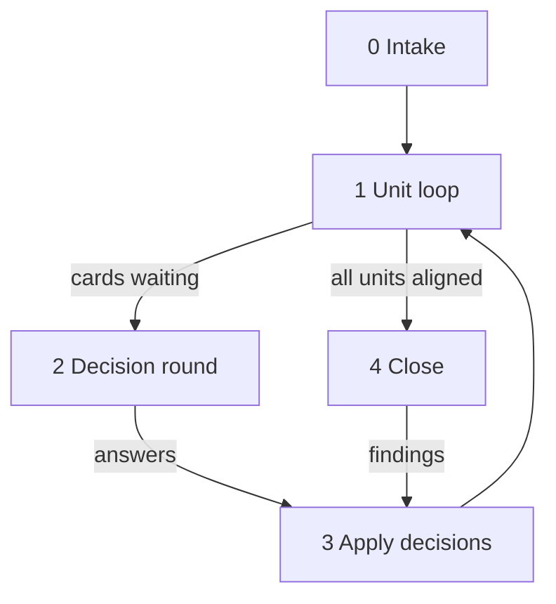

# Docs Repair Workflow

Load on `/docs-repair`. Also load `tech-docs.md`, `tech-docs-templates.md`, and the tech skills for the code in scope (Section 3). Apply `copilot-instructions.md` Sections 2–4.

**Purpose:** Bring an existing project’s docs and code comments back in line with the implementation, and up to the `tech-docs.md` standard. Evidence decides which side is right. When evidence does not decide, a person does, from a decision card that carries the full context.

## 1) Principles

- Neither side is presumed right. Running code is not proof of intent. A doc is not proof either.
- Fix doc-side drift in this workflow. Code-side drift becomes a review finding that `workflow-implement.md` executes; a behavior change needs tests and a review.
- Write only what the source shows. Never invent a motivation. An unknown reason on a non-obvious choice is a card (`why-unknown`), not a guess.
- State lives in the ledger, never only in chat. Any run resumes from it. The ledger is workflow history (git-ignored): every durable outcome — an answer, a domain fact, a decision — also lands in its home (`docs/domain/`, `docs/decisions/`, `docs/architecture.md`) when it is applied.
- Scope: docs against code. Requirements, test content, and the trace: `/dream`.
- Git stays read-only (Section 4.11). `git log -S`, `git log --follow`, `git blame`, `git show` are evidence tools.

## 2) Phases



## 3) Ledger

`docs-repair/<slug>.md`. Slug rules: `workflow-plan.md`. Sections in this order:

````markdown
# Docs repair — {scope}

**Status:** intake | looping | waiting | closing | done
**Position:** {current unit} · next: {units}
**Counts:** units {aligned}/{total} · drift {open} open · {waiting} waiting · {applied} applied · findings {n}

## Units

| Unit | Paths | Status |
|------|-------|--------|
| Cli | [`src/Cli/`](../src/Cli/) | aligned |

## Docs inventory

| Doc | Category (home) | Status |
|-----|-----------------|--------|
| [`README.md`](../README.md) | README | aligned |
| [`docs/design.md`](../docs/design.md) | misplaced: architecture + guide | open |

## Drift

{Drift cards, grouped by unit.}

## Findings

{Code-side findings handed to `/implement`: links to `reviews/review_docs-repair-<slug>_<n>.md`.}
````

Status sets (closed; no other words):

| Item | Statuses |
|------|----------|
| Unit | `open` · `wip` · `aligned` · `waiting` (holds a card) · `excluded` |
| Drift card | `open` · `waiting` · `answered` · `applied` · `excluded` |

## 4) Drift kinds and autonomy

| Kind | Meaning | Action |
|------|---------|--------|
| `doc-stale` | Doc describes behavior the code no longer has; evidence shows the code is intended | Fix the doc |
| `doc-missing` | Behavior, structure, or a member has no doc at its home | Backfill per `tech-docs.md` |
| `doc-misplaced` | Fact outside its home, or copied | Move to the home; link elsewhere |
| `doc-orphan` | Doc describes something that does not exist | Remove when git shows the removal; else card |
| `comment-stale` | Comment contradicts the code | Fix the comment; card when the comment states intent the code breaks |
| `code-drift` | A contract (requirement, accepted decision record, architecture boundary or dependency direction, published API doc, test) states the behavior; the code differs | Card, then finding |
| `conflict` | Both sides are plausible | Card |
| `why-unknown` | Non-obvious choice; no source shows the reason | Card (low priority); no comment until answered |

**Decide alone** (no card) only when one of these holds and nothing contradicts it:

- A passing test asserts the current behavior, and no contract states otherwise.
- Git shows a deliberate change after the doc was written (the commit message or a CHANGELOG entry names the behavior).
- The doc is a comment or internal doc, and the code is the only consumer of the claim.

**Always a card:**

- A contract doc would change: requirement, accepted decision record, architecture boundary or dependency direction, published package README or API doc, security or limits doc, data format, persisted state, CLI or wire output.
- A test, a contract, and the code disagree in any combination.
- The code looks like a defect (off-by-one, swallowed error, unreachable branch).
- A fix would change behavior a caller can observe.

Never fix code silently. Never mark a drift item `applied` because the fix “should” hold; the Sync check ran.

## 5) Decision card

The reader did not watch the audit. The card alone must let them decide. Fields follow Section 4.16 (questions).

````markdown
### DRIFT-EXPORT-RETRY-COUNT — Retries: docs say 3, code does 5

Status: waiting · Kind: conflict · Unit: Export · Impact: High

**Doc says:** “A failed upload is retried 3 times.” — [`docs/architecture.md`](../docs/architecture.md) § Upload

**Code does:**
[`src/Export/Uploader.cs`](../src/Export/Uploader.cs) `Uploader.SendAsync`
```csharp
private const int MaxAttempts = 6; // first try + 5 retries
```

**Evidence:**
- Test `SendAsyncRetriesFiveTimes` asserts 5 retries ([`UploaderTests.cs`](../src/Export.Tests/UploaderTests.cs)).
- `git log -S MaxAttempts`: one commit, “raise upload retries for flaky proxy”.
- No requirement or decision record names a retry count. README is silent.

**Who is affected:** operators sizing timeouts; worst case 6 × 30 s instead of 4 × 30 s.

**Assessment:** the code is probably intended (test plus a deliberate commit). Confidence: medium; the commit does not say whether the doc was meant to follow.

**Question:** Which retry count is the contract?

**Options:**
- A) 5 retries (code). The doc changes; behavior unchanged. Timeouts in the ops guide grow to 180 s.
- B) 3 retries (doc). `MaxAttempts` becomes 4; the test changes; flaky-proxy uploads may fail again.
- C) Configurable, default 5. Code, doc, and a limits row change (Section 4.2); needs `/plan`.

**Recommendation:** A, because the test and the commit both show intent and no contract says 3.

**Answer:**
**Applied:**
````

- ID: `DRIFT-<AREA>-<TOPIC>`, token rules of `tech-spec.md`. Stable. Never in code or comments.
- Quote the doc verbatim. Show the code as a fenced snippet with path link and symbol.
- Name every evidence source checked, including the silent ones.
- Every option names what changes, for whom, and what it risks.

## 6) Phase 0 — Intake

1. Confirm scope (whole repository, components, or doc sets) and exclusions. Record `excluded` with a reason.
2. **Docs inventory:** every Markdown file outside workflow folders, plus generated reference docs. Book each with its home from `tech-docs.md` § Doc set, or `misplaced` with the homes it mixes.
3. **Units:** one per component (project, crate, package, top-level source folder). A unit over ~40 files or ~8000 lines splits by folder.
4. **Overview first:** when `docs/architecture.md` has no Overview, draft the component table from build files, project references, and folder structure (template). It is the navigation backbone for the loop and gets refined per unit.
5. Write the ledger, status `looping`. Chat: unit count, doc count, first unit.

## 7) Phase 1 — Unit loop (autonomous)

Per unit, in dependency order (leaves first):

1. **Read:** the unit’s architecture section and domain entries, then every source file of the unit in full, its tests, and its build file.
2. **Collect claims:** grep the unit’s name, paths, public symbols, options, and messages across every inventoried doc; read the matching sections. Add the unit’s doc comments and inline comments.
3. **Check each claim** against code and tests. Mismatch → drift card. No doc at the home → `doc-missing`. Check the unit’s real dependencies (build file references, imports) against the architecture’s dependency directions.
4. **Gather evidence** for each card: tests, callers, git history, contracts, other docs.
5. **Apply autonomy** (§4). Decide-alone items: fix now. Card items: status `waiting`, no edit.
6. **Backfill** the unit to `tech-docs.md`: doc comments on every member with Related links (meaning or dependency, never usages), block comments that pass the comment-only read, tags, named sections, `Sync:` on both ends of each coupling, the unit’s architecture section (flow, invariants, **Easy to miss**), concepts and domain facts the code shows. Remove file headers that repeat the type doc. Comment edits never change code behavior; a needed code change is a card.
7. **Sync check** (`tech-docs.md` § Sync check) over the unit. Build and tests stay green: run the tech skill’s build and the unit’s tests in Release (doc comments can break builds: cref, intra-doc links, doctests).
8. Unit status: `aligned` when nothing waits, else `waiting`. Update ledger **Position** and **Counts**. Chat: one line per unit.

Continue with the next unit while cards wait. A unit waits only for its own cards.

## 8) Phase 2 — Decision round (human)

- Trigger: every unit is `aligned` or `waiting`, or 10 cards are `waiting`.
- Ask in rounds of at most 10 cards, highest impact first. Paste each card in full in chat (Section 2: chat language follows the user; the card stays English in the ledger).
- The person may answer in chat or in the ledger **Answer** field. Copy chat answers into the ledger.
- An answer that raises a new fork is a follow-up card; cite the prior answer.

## 9) Phase 3 — Apply decisions

- Doc-side answer: edit, run the Sync check, fill **Applied** with the files and the Sync-check line, status `applied`. An answer that states a domain fact goes into `docs/domain/` (`tech-spec.md`); an answer that settles a design choice gets a decision record.
- Code-side answer: write a finding in the `workflow-review-templates.md` Shared Block format (Problem/Fix plus the test that must fail before the fix) to `reviews/review_docs-repair-<slug>_<n>.md`. The card answer is the acceptance. Run `workflow-implement.md` on those findings (Stage 5 skipped). Then fix the doc side, fill **Applied**, status `applied`.
- Answer needs a feature or a new limit (option C above): record it as out of scope for this run, status `excluded`, and name `/plan` as the next step in the report.
- Re-open the unit and return to Phase 1 step 7 for it.

## 10) Phase 4 — Close

1. Write or refresh `docs/architecture.md` (Overview on one screen), and `docs/concepts.md` and `docs/domain/` when they have content, from the units (templates). Each component’s entry type links its architecture section. Refresh `README.md` Documentation links.
2. Run the Sync check over the whole scope: every link, path, symbol, documented command.
3. Run `workflow-implement.md` § Review until clean on the repair scope with `tech-docs.md` loaded. Its findings go through Phase 3.
4. Ledger status `done` when every unit is `aligned` or `excluded` and every card is `applied` or `excluded`. Else `waiting`.

## 11) Completion

Chat: ledger path, counts per drift kind and status, each waiting card in full, findings files, excluded items with the next workflow. Then the run report (`tech-reporting.md`): **Not done** lists units not `aligned` and cards not `applied`; **Needs you** holds the waiting cards. Do not recap fixed items.

## 12) Loop rules

- One writer per ledger.
- Same tool call with the same result twice: change strategy (Section 4.14).
- Two failed fixes of the same root cause: card or blocker per `tech-reporting.md`; continue elsewhere.
- Never delete a doc the inventory lists without a `doc-orphan` or `doc-misplaced` card that shows where its facts went.
