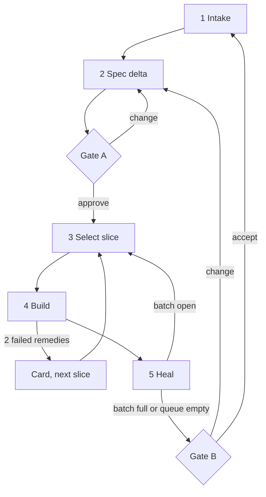

# Evolve Workflow

Load on `/evolve`, or when the user dictates what the software must do and asks to build it. Apply `copilot-instructions.md`. Also load now: `tech-spec.md`, `tech-reqtrace.md`, `tech-reporting.md`, `tech-docs.md`.

**Purpose:** Develop one product continuously from requirements. The person states what it must do. The agent specifies, plans, builds, tests, verifies, documents, and repairs. The person acts only at three gates.

Language and product type do not matter. Composes the existing workflows.

## Gates

| Gate | When | Person sees | Budget |
|------|------|-------------|--------|
| A — Spec | After a Spec delta | Spec delta | `tech-reporting.md` |
| E — Escalation | A Decision-class point or blocker | Decision cards | Batched; asked when no selectable work is left, or at the next gate |
| B — Release | After a batch | Briefing | `tech-reporting.md` |

No other human stop exists. Plans and findings are agent handoffs; a person reads them only on request. A project may add a gate in `spec/state.md` `Gates:` (`plan`).



## Stage 0 — Resume

- State lives in files. Read `spec/state.md`, then `spec/open.md`. Missing: create `spec/` per `tech-spec.md`.
- Find the `reqtrace` call form (`tech-reqtrace.md` § Call form). No row matches: put the install request in the next Spec delta (`tech-reqtrace.md` § Setup, step 3); until it is approved, run the checks by search.
- Read **Builder**. Unset: take the model the person named in the request; else ask with the **Builder** line of the next Spec delta (§ Builder). Until it is set, the Lead builds.
- Apply answered cards first: patch the spec, re-queue the blocked slice, fill **Applied**.
- Existing code without a spec: specify only what this input touches. Full backfill only on request.
- Resume at **Position**.

`spec/state.md` holds exactly these lines. `Status` is one of `intake` · `gate-spec` · `building` · `gate-release` · `waiting` · `idle`. `Queue` has one line per slice: name — requirement IDs — depends on — blocked by. `Builder` is the model the Builder subagent runs on, written as the tool accepts it, or `none — {reason}` (§ Builder). Update the file at every stage change and before every stop.

```markdown
# State

Status: building
Position: reject-duplicates · Stage 4
Gates: spec, release
Builder: {the cheaper model, as the person named it}
Queue:
- reject-duplicates — REQ-EXPORT-NO-DUPLICATE — depends on create-and-list
- rename — REQ-EXPORT-RENAME — depends on create-and-list — blocked by Q-EXPORT-RENAME-HISTORY
Batch: slices 1 · production lines ~180 · since last Gate B
Last dream: 3f2a91c · full: 9be01d4
```

## Stage 1 — Intake

Dictated input is noisy. Read all of it. Lose nothing.

Sort each statement:

| Kind | Goes to |
|------|---------|
| Obligation | Requirement |
| Test idea, edge, “it must not…” | Test card |
| Domain fact, also in passing | `docs/domain/` now (`tech-spec.md`) |
| Preference on how to build | Which model builds: the `Builder` line (§ Builder). Other lasting preference: propose a line for `custom_instructions.md` (or a skill change) in the Spec delta; never write either unasked. This work only: a plan constraint |
| Open fork | Section 4.16: decide or card |

Copy the depth, not the content:

```text
Dictated: "Exports need names, and, uh, no two the same. Our auditors call a corrected invoice
           a credit note, by the way. It has to be fast. Oh, and use SQLite for it."
Obligation:  The system shall let an operator name an export.
Obligation:  The system shall not accept a second export with an existing name.
Test idea:   Submit the same name twice; one row remains.
Domain fact: "Credit note" = a corrected invoice. Source: user, in passing → docs/domain/ now.
Open fork:   "Fast" has no measure → propose measure and target as an Assumption in the Spec delta.
Preference:  SQLite → a new dependency: New Dependency Protocol in the Spec delta.
Preference:  "let {model} build it" → Builder: {model} in spec/state.md, the name exactly as said.
Wrong:       Keeping only the two obligations and dropping the other four lines.
```

Then size the work. Pick the smallest fit. A condition of S that is uncertain is not met:

| Size | Fits when | Route in Stage 4 |
|------|-----------|------------------|
| S | ≤ 3 production files; no public API, format, or security change | No plan file. Failing test, fix, `/review` on the change |
| M | One slice | Plan with one step, then implement. One Closing Review; no Step `{n}R` |
| L | Several slices | Full plan per slice |

## Stage 2 — Spec delta

Execute `workflow-requirements.md` in Delta mode. Then write the test cards per `tech-spec.md`: at least one per new requirement and every applicable class in `tech-test.md`. Then write the Spec delta (`tech-reporting.md`).

An S-size fix that changes no obligation skips this stage and Gate A.

## Gate A — Spec

Show the Spec delta. Set `Status: gate-spec`. Stop.

- Approve → set the delta's requirements and cards `active`. Approved install request: run `tech-reqtrace.md` § Setup steps 4–8. Run `reqtrace accept --allow-gap "cards and tests follow in the slices"` (`tech-reqtrace.md` § Accept); refused for anything but L4 or L6 → fix, accept again. Cut slices. Fill **Queue**. Write **Builder** from the delta's **Builder** line.
- Change → patch and show only what changed. Stop again.
- ❗ Only explicit words approve. A question, a comment on one entry, or silence is Change or no answer, never approval.
- Approval covers planning and implementing these requirements, the listed public API, agent surface, limits, and dependencies.

## Stage 3 — Select slice

- Cut slices by what a person can try, smallest first, in dependency order. A slice ends in something a person runs or sees; “the data layer” is no slice.
- Pick the first selectable: a re-queued slice, else `Position`, else the next without an open blocker.
- ❗ One slice per session when the context window is ≤ 200k tokens or unknown. Before ending: update `spec/state.md`.
- None selectable: show each open card in full (Gate E), `Status: waiting`, run report.

## Stage 4 — Build

Load the tech skills of the slice (Section 3).

1. **Size S:** write the failing test, fix, add the code tests of every member the fix changed with their ledger line (`tech-test.md` § Code tests), run the Sync check (`tech-docs.md`), run `/review` on the change (`workflow-review.md`). Fix and review again until zero Errors and zero High Performance findings. Go to step 5.
2. **Plan:** `workflow-plan.md` in Autonomous mode.
3. **Card tests first:** the Builder writes them when one is set (§ Builder); the Lead checks each against its card. Turn the slice’s cards into tests, each with its marker (`tech-spec.md` § Trace). Run them. ❗ Each new test fails for the expected reason before the code exists: its assertion fails, or the member under test does not exist yet. A typo, a setup error, or a missing fixture is not the expected reason; fix the test first. Run `reqtrace check` → no L6 left for these cards.
4. **Implement:** `workflow-implement.md`. It makes these tests pass and never rewrites them; a card test changes only through its card. After each Edit it adds the code tests of what it wrote (Stage 2 item 3, `tech-test.md` § Code tests): the cards are the minimum, not the suite. Size M skips Step `{n}R`; size L keeps it. Its Closing Review covers the slice. With a Builder, each step goes through § Builder.
5. **Prove as a user:** run each Done-when through the real boundary: the browser for a UI, the process for a CLI, HTTP for an API, a consumer call for a library. A green unit suite is not proof. Tick `Met` only then. A Done-when that fails here is a failed `Verify` (Section 4.15).

```text
Wrong: The tests pass, so REQ-EXPORT-NO-DUPLICATE is `Met ✅`.
Right: Run `export create Report` twice in the built CLI, read the output, see the error and one row, then tick.
```

Two failed remedies of one root cause: write a card, mark the slice blocked, continue with the next (Section 4.15).

Never edit an `active` requirement to make it pass. A wrong requirement is a card.

## Builder

The session that runs `/evolve` is the **Lead**; start it with the strongest model you have. A **Builder** is a subagent on a cheaper model that turns one finished plan step into tests, code, and docs. The Lead decides; the Builder types.

**When:** size M or L, the tool can start a subagent on another model, and **Builder** is not `none`. Use the tool's own way to start it and pick its model: a model parameter, a named agent, or a setting. A condition fails, or the subagent can only inherit the Lead's model (it saves nothing): the Lead builds every step, and the run report says once: `Builder: none — {reason}`. ❗ Never a subagent for the plan, test cards, a review, or a gate (Section 4.14).

**Choose once, before the autonomous part:** the person names the model in the `/evolve` request, or the first Spec delta asks with its **Builder** line. Gate A writes it to `spec/state.md`. Never ask again; the person changes it by saying so. ❗ Write the name exactly as the person gives it. Never fill in a model, vendor, or version from an example or from memory: model names change weekly and differ per tool. The person's name does not resolve in the tool → `Builder: none — {name} not available here`, and say so in the run report.

| Work | Who | Why |
|------|-----|-----|
| Intake, Spec delta, gates, test cards with **Content**, plan with locked `How` | Lead | Judgment and the conversation with the person |
| Test code from the cards, production code from `How`, code tests from the written code, docs from `Docs`, `Verify` | Builder | Most tokens; the plan leaves no choice |
| Handoff check, Step `{n}R`, Closing Review, Prove as a user, Heal | Lead | The author never reviews its own work |

**Handoff:** one step at a time, one Builder at a time (one working tree). The brief holds only this; copy the depth, not the content:

```text
Build Step 3 of plans/plans_export.md. Read .github/copilot-instructions.md, then the whole plan.
Load: tech-csharp.md, tech-test.md, tech-tunit.md, tech-docs.md (the plan's Loaded skills line).
Do: workflow-implement.md Stage 2 items Edit, Tests, Docs, Verify, for this step only.
Write only: the step's Where files, the test files of its Tests cards and of its code tests, its Docs files.
Never: spec/**, the plan, another step, a test that differs from its card's Content, a git write.
Card tests first: write them, run them, and keep each failure line before writing code.
Code tests after the code: walk each member you added or changed (tech-test.md § Code tests).
Decide nothing of Decision class (Section 4.16): stop and report it.
Report: done | blocked — {reason} · the model you ran on · files changed · the Verify command and its
last lines · the red-run lines of the card tests · the Code tests ledger line · each difference from How ·
user-visible behavior a code test showed that no requirement names · domain facts learned · open questions.
```

**Check every handoff.** Never trust the report:

1. `git diff --stat` shows only files the brief allows. Any other file: undo that edit, then treat it as a failed handoff.
2. Each new marked test, next to its card **Content**: the setup, action, and observable are there, and the red-run line failed for the expected reason (Stage 4 step 3). A test that cannot fail fails the handoff.
3. Each member the diff adds or changes is in the Code tests ledger line; each booked test exists and asserts an exact value, error code, or message (`tech-test.md` § Code tests). A member without a booking fails the handoff.
4. Run `Verify` yourself.
5. The model in the report differs from **Builder**: say so in the run report. Some tools fall back to another model without telling.
6. Write the reported domain facts (`workflow-implement.md` Stage 2 item 5). Put each reported user-visible behavior that no requirement names into the next Spec delta as a proposed card. Then continue that Stage 2 from item 7.

**A failed handoff:** sharpen the step's `How` with what was missing and hand it off once more. Fails again: the Lead builds the step. Two failed remedies of one root cause → card (Section 4.15).

```text
Wrong: The Builder reports "done, all green". The Lead ticks the step.
Right: The diff lists src/Store.cs and spec/tests/export.md. The brief did not allow the spec file: the Lead
       undoes that edit, quotes the "Never: spec/**" line, and hands the step off again.
```

## Stage 5 — Heal

Run `workflow-dream.md` in `touched` mode on the slice’s areas. Update **Batch**.

Gate B when any holds:

- The queue is empty.
- The batch holds 3 slices or ~1000 production lines.
- A change marked **Judge** (`tech-reporting.md`) is in the batch.

Otherwise go to Stage 3. Run `/dream full` after 10 slices or 20 inbox lines (ask at the next gate; never block on it).

## Gate B — Release

Write one briefing for the batch (`tech-reporting.md` § Briefing). Show its head (**Verdict** to **Attention**) and **Concept** in chat, with the link to the file. Set `Status: gate-release`. Stop.

- Accept → run `reqtrace accept`; it records the batch's new markers, so C2 guards them from now on. Refused → L4 or L6 on an entry of a slice still in **Queue**: accept again with `--allow-gap "<slice> is queued"` or `"<slice> is blocked by Q-…"`. Any other finding is an Error of the batch: fix it, `check`, accept again. Reset **Batch**. `Status: idle`.
- Change → the change is new input: go to Stage 1.

## Completion

Stop conditions, closed set:

| Stop | Meaning |
|------|---------|
| `gate` | Waiting at Gate A or B |
| `waiting` | Only cards remain |
| `budget` | Session limit reached; state saved |
| `idle` | Queue empty, batch accepted |

Chat: the run report (`tech-reporting.md`) on every exit.
