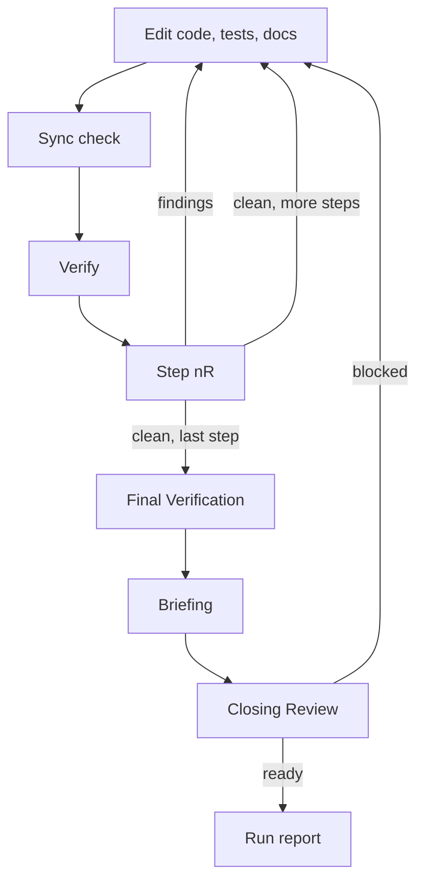

# Implement Workflow

Load on `/implement`. Apply `copilot-instructions.md` for all quality, tech, git, and communication rules.

**Purpose:** Implement approved plan steps or accepted review findings **exactly**. Complete every item in scope. Review each step, write an **extensive briefing**, then run one **Closing Review** of the whole result. End **every** run, complete or not, with the run report (Section 4.16).

## Stage Order

1. Prepare
2. Execute Steps
3. Final Verification
4. Briefing
5. Closing Review
6. Run report

## Gates

Each gate catches a different class of defect. None repeats another’s work. Never skip a gate because a later one will run.

| Gate | Scope | Catches |
|------|-------|---------|
| Sync check | Touched code and docs | Docs and comments that no longer state the truth |
| `Verify` | The step’s claim | The step does not do what it says |
| Step `{n}R` | The step’s change and its direct callers | Defects inside the step |
| Closing Review | Everything the run built, with plan and requirements | Defects that exist only when steps combine; requirements that fail end to end |



## Stage 1 — Prepare

- Require an approved plan or accepted review findings (Section 6); stop otherwise.
- ❗ Read the **entire** plan (or finding file) **before the first edit**. Do not skim Step Overview and skip `How`. Read the requirements artifact and every linked architecture doc, guide, or doc **in full**.
- Run the Tech Load Protocol (Section 3); it always includes `tech-docs.md`. Read before acting (Section 4.6, `tech-docs.md` § Reading tiers).
- Resume at the first `⚠️`, else the first `🚧`, else the first `⬜`.

## Stage 2 — Execute Steps

Process every step, dedicated test step, and finding in scope, in topological order. Skip none. Per item:

1. **Start:** set `🚧` on every status surface before the first edit (Section 5). Plan: Step Overview, Shared Block, Task Checklist. Finding: its `Status` line and the Summary **Findings** Status cell.
2. **Edit:** implement only the current scope. Match `What` and `How` exactly, including plan Before/After or finding Problem/Fix. Do not substitute, simplify, or extend without user approval. Run the Impact search (`tech-docs.md` § Impact search) before the first edit in each file. A needed break of a documented boundary, flow, or invariant that the plan did not agree is a stop (Stage 6 **Needs you**).
3. **Tests:** implement the **Content** of each `TEST-<AREA>-<TOPIC>` on the step. Mark its row `✅` when the Content exists as a test that can fail. Extra tests that prove agreed behavior are allowed.
4. **Docs:** update every file in the step `Docs` field and every Impact-search hit in the same item. Run the Sync check (`tech-docs.md` § Sync check) and record its line in the Implementation Status Table.
5. **Verify:** run the item’s `Verify`; require pass. Run only the tests that cover the item (`tech-test.md`). On failure follow Section 4.15 and the step `Debug` block.
6. **UI:** a product web UI change → use the integrated browser on the running UI (Section 4.8).
7. **Align:** compare target and actual; no silent deviation. Confirm the step `Acceptance` boxes and, for new public APIs, the plan’s misuse/abuse checklist.
8. **Requirements (step close):** re-read the **linked** requirements file. Run Done-when for each requirement ID still `⬜` that this step could have made true. Tick `Met` in that file only when the check **ran**, never because `How` alluded to the outcome. Never write requirement or test IDs into code or comments.
9. **Step `{n}R`** (plan steps): run `/review` on the step’s change — the files it touched, their direct callers, and its `Docs` files. A full review may reuse this step’s `Verify` run when no file changed since; say so in **Test Execution**. Zero Errors and zero High Performance findings before the next step; remediate here and re-review. Complex-task: persist per `workflow-complex-task.md`.
10. **Close:** set `✅` on every surface after `Verify`, alignment, requirement and test ticks, the Sync check, and a clean Step `{n}R` (findings: no Step `{n}R`). Do not rewrite a review’s **Release** or **Counts**; they stay the review-time verdict. A deferred finding stays `⬜`. Chat-only review: record the finding in the Implementation Status Table and say the Summary Status cell was not persisted.

- **Phase close:** when the plan has phases, run the phase’s `How to try` from **Expected Experience** after its last step. A mismatch with `They should see` is a Problem (Stage 6).
- **Stop:** two failed remediations of the same Error root cause → blocker (Section 4.16), set the item to `⚠️` on every status surface, then Stage 6. An item left without a blocker (pause, user abort) stays `🚧`. Any other stop (out-of-scope discovery, unexpected diff, missing decision, user abort) → Stage 6.

## Stage 3 — Final Verification

- Confirm **every** scoped step, test ID, and finding is `✅` on every status surface. Leftover `⬜` / `🚧` / `⚠️` = blocker (Section 4.16).
- Re-run alignment: every requirement ID with Done-when Met ✅, every test ID ✅, or every accepted finding resolved.
- Run the full build and all tests in optimized/Release. Commands from the loaded tech skill.
- Web UI: run the planned Playwright journeys and walk the changed pages in the integrated browser (Section 4.8).
- Output the Implementation Status Table (every step, finding, and test ID).
- Do not enter Stage 4 until this stage is green.

## Stage 4 — Briefing

Write the briefing before Stage 5, also when Stage 5 is skipped. No complete without it. Call it a **briefing**, never a “review brief”.

The briefing is the human packet for what shipped. It must be **extensive**: a reader who did not watch implementation knows what shipped, why it had to, how to try it, what to inspect in each file, which acceptance checks now hold, and what is out of scope. English (Section 4.6). ❗ Incomplete without contribution, how to try the result, and what to inspect. Do not compress **How it serves**, **Why needed**, or header **Why**.

- Path: `reviews/briefing_<slug>.md`. Single item: `reviews/briefing_<slug>_<item>.md` (`step{n}` / finding ID). Before the Closing Review: full-scope file.
- List every created, edited, or deleted path, docs included. Omit none. Rewrite on remediation.
- Describe the built result: symbols, behavior, contracts. Small illustrative snippets (signatures, usage) help; a raw diff does not.
- Requirement IDs, test IDs, and `E{n}` links belong in the briefing (reader aid), never in product code. Requirement links use the plan **Requirements** path (default `requirements/req_{slug}.md`). Test-ID links use the plan path and the lowercased ID as fragment (`#test-export-no-duplicate`).
- Card heading: clickable relative link (Section 4.6), label = repo-root path in backticks. Deleted: same link + `(deleted)`. Sibling files may share one card. Walkthrough steps that name a file use the same link form.
- Field order per card: **Changed** → **Why needed** → **How it serves** → **Look at** → **Depends on** → **Serves**.
- **How it serves:** per linked requirement ID / test ID / `E{n}`, full sentences: which symbols, what exists or is gone, what a caller can or cannot do, which Done-when this file owns. Unique to this file. Ban slogans, ID-only, “as planned”, empty purpose.
- **Look at:** where a reader should spend time (type, method, invariant).
- Reading order: contracts/types → implementations → cutover → tests → docs.

```markdown
# Briefing — {scope}

**Expect:** {outcome}
**Done when:** {checks the reader can run}
**Why:** {problem without this work; what stays wrong if it does not ship}
**Out:** {exclusions}
**Open:** {Stage 6 **Not done**, **Needs you**, and **Problems** items; or `none`}

**Try this:** {exact commands, Playwright spec, or usage snippet; expected observable}

**Acceptance evidence:**
- REQ-EXPORT-CREATE ({short outcome}): {command/UI/API and what was observed} · [REQ-EXPORT-CREATE](../requirements/req_{slug}.md)
- TEST-EXPORT-NO-DUPLICATE ({case}): {test filter or spec and result}

**Public API:** {short snippet or "unchanged"}

**Performance:** {hot-path allocation notes, or "not in hot path"}

**Docs:** {docs and comment sets updated, with links; Sync check result}

**Requirements:** [REQ-EXPORT-CREATE](../requirements/req_{slug}.md) {short outcome} · [REQ-EXPORT-TIME-BUDGET](../requirements/req_{slug}.md) {short property}

**Test cases:** [TEST-EXPORT-NO-DUPLICATE](../plans/plans_{slug}.md#test-export-no-duplicate) {short name} · [TEST-EXPORT-EMPTY-NAME](../plans/plans_{slug}.md#test-export-empty-name) {short name}

## Walkthrough

1. {Open this file; confirm this symbol / AC}
2. {Then this}

## Files

1. [`{path}`](../{path})
   - **Changed:** {symbols/behavior}
   - **Why needed:** {what fails without this file — several sentences if needed}
   - **How it serves:** [REQ-EXPORT-CREATE](../requirements/req_{slug}.md): {causal contribution unique to this file}. [TEST-EXPORT-NO-DUPLICATE](../plans/plans_{slug}.md#test-export-no-duplicate): {how this file makes that test ID’s Content possible}
   - **Look at:** {symbol and what to verify}
   - **Depends on:** —
   - **Serves:** [REQ-EXPORT-CREATE](../requirements/req_{slug}.md), [TEST-EXPORT-NO-DUPLICATE](../plans/plans_{slug}.md#test-export-no-duplicate)

2. `{path}` (deleted)
   - **Changed:** {what went away}
   - **Why needed:** {what the deleted type blocked or enabled wrongly}
   - **How it serves:** {type is gone; callers must use …; Done-when this deletion closes}
   - **Look at:** callers listed in Depends on / Serves
   - **Depends on:** 1
   - **Serves:** [REQ-EXPORT-CREATE](../requirements/req_{slug}.md)
```

## Stage 5 — Closing Review

- Run `workflow-review.md` in **Closing Review** mode on the full built scope: every path in the briefing, their callers, the plan, the requirements file, and the Step `{n}R` reviews. File mode: `reviews/review_<slug>-closing_<n>.md`, `n` from 1.
- **Ready** → Stage 6.
- **Blocked** → remediate each Error and High Performance finding through Stage 2 (status ticks, `Verify`, Sync check). Re-run Stage 3 for the touched scope, rewrite Stage 4, then run the Closing Review again as `_<n+1>`. Two failed remediations of the same root cause → blocker (Section 4.16).
- Cosmetic, Refactoring, and other Performance findings are in scope: fix them the same way unless the user defers them. A deferred finding stays `⬜` and appears under **Not done** in Stage 6. `/complex-task` defers them per its Stage 5.
- Skip this stage when the parent is `workflow-complex-task.md` per item, `workflow-review-loop.md`, or `workflow-docs-repair.md` (each runs its own closing review). Still run Stage 4.
- **Exam (on request only):** when the user asks for it (`exam`, `with exam`, `/council exam`), run `workflow-council.md` Exam after the Closing Review is Ready. `quick` / `lite` → Lite Exam. **Holds** → Stage 6. **Does not hold** → remediate the kill shots like Blocked findings, then re-Exam `_<n>`.
- Grill Me follow-ups → ask the user (Section 4.16 question form); the run is not complete.

## Stage 6 — Run report

Write the run report of Section 4.16 on **every** exit: complete, blocked, failed, paused, aborted. It is the last chat message of the run, in the user’s language (Section 2). A parent (`workflow-complex-task.md`, `workflow-review-loop.md`, `workflow-docs-repair.md`) reports once, at its end or at its first stop.

What goes where:

- **Not done:** steps, test IDs, and findings still `⬜`, `🚧`, or `⚠️`; deferred findings; checks that did not run (Final Verification, Closing Review, phase `How to try`).
- **Needs you:** unresolved `C{n}`, plan Open Questions, Grill Me follow-ups, out-of-scope discoveries, deviations that need approval.
- **Problems:** failed `Verify`, red build or test, unmet Done-when, Closing Review **Blocked**, Exam **Does not hold**, phase mismatch, two-attempt cap, environment collision. One entry per root cause.
- **Deviations:** a step built differently from its `How` or Before/After, or a finding fixed differently from its Fix.

Link each item to the plan step, finding, or file (Section 4.6, from repo root). Do not paste Shared Blocks or the briefing. Mirror **Not done**, **Needs you**, and **Problems** in the briefing **Open** field when a briefing exists.

Copy the depth, not the content:

```markdown
**Implement ⚠️ stopped at Step 3** — export: 2 of 5 steps ✅ · Plan [`plans/plans_export.md`](plans/plans_export.md) · Briefing [`reviews/briefing_export.md`](reviews/briefing_export.md)

**Not done**
1. ⚠️ [Step 3 — Add store](plans/plans_export.md#step-3---add-store): stopped; `Verify` failed twice (Problem 1).
2. ⬜ [Step 4 — Wire UI](plans/plans_export.md#step-4---wire-ui), [Step 5 — Requirements fit](plans/plans_export.md#step-5---requirements-fit): not started; depend on Step 3.
3. ⬜ Final Verification, Briefing, Closing Review: not run.

**Needs you**
1. Context: export, Step 3 adds the store. The plan says names are unique per user ([requirements](requirements/req_export.md) REQ-EXPORT-NO-DUPLICATE); `IExportStore` in [`src/Store.cs`](src/Store.cs) has no atomic add, so two parallel requests can both pass the check. Why it matters: decides whether Step 3 needs a store change. Question: may Step 3 add `IExportStore.TryAdd`? Options: A) add `TryAdd` (atomic, one more interface member, one more test) · B) keep check-then-add and document the race (duplicates possible under load). Recommendation: A, because B ships a known violation of REQ-EXPORT-NO-DUPLICATE. Or answer in your own words.

**Problems**
1. ❌ Requirement not met: [REQ-EXPORT-NO-DUPLICATE](requirements/req_export.md) Done-when “a second create with the same name returns `DuplicateName`”. Ran `dotnet test --treenode-filter "/*/*/ExportStoreTests/*"`: `CreateTwiceInParallel` → 2 rows. Gap: no atomic check-and-add. Impact: duplicate exports for users who double-click. Scope: Step 3 blocked; Steps 1–2 stand. To unblock: decision 1.

**Deviations**
none
```

- When everything is `✅`, **Not done**, **Needs you**, **Problems**, and **Deviations** each say `none`.

## Implementation Status Table

```markdown
| Step / Finding | Status |
|----------------|--------|
| Step 1 - {title} | ✅ Complete · Sync check: updated `docs/architecture.md` § Run |
| Step 1R - Review Step 1 | ✅ Clean - 0 Errors |
| TEST-EXPORT-NO-DUPLICATE - {case} | ✅ |
| Step {N} - Requirements fit | ✅ Every requirement with Done-when Met |
| REQ-EXPORT-CREATE - {outcome} | ✅ Met |
| E1 - {title} | ✅ Fixed · Sync check: none needed (private helper, no doc claim) |
| Briefing | ✅ reviews/briefing_<slug>.md |
| Closing Review | ✅ Ready · reviews/review_<slug>-closing_1.md |
```
