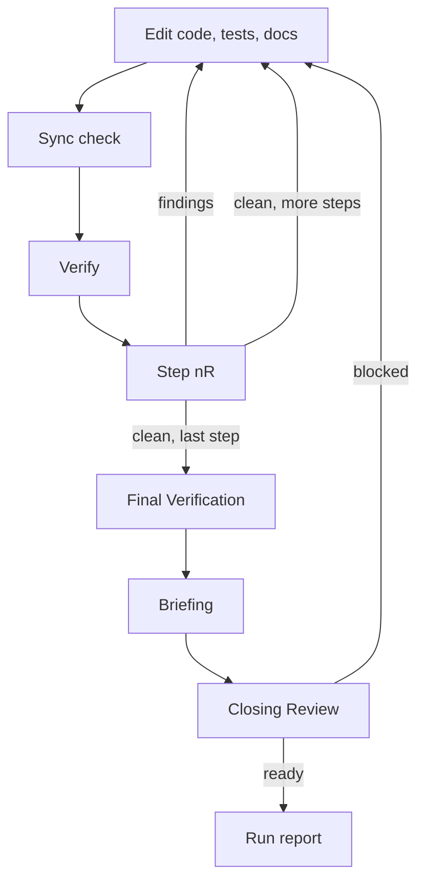

# Implement Workflow

Load on `/implement`, or from `/docs-repair`, `/port-dotnet-rust`, `/port-dotnet-rust-loop`, or `/evolve`. Also load now: `tech-spec.md`, `tech-reqtrace.md`, `tech-docs.md`. Apply `copilot-instructions.md`.

**Purpose:** Implement approved plan steps or accepted review findings **exactly**. Complete every item in scope. Review each step, write the briefing, run one Closing Review. End every run with the run report.

## Stages

1. Prepare
2. Execute Steps
3. Final Verification
4. Briefing (read `tech-reporting.md` now)
5. Closing Review
6. Run report

## Gates

Each gate catches a different defect class. Never skip one because a later one will run.

| Gate | Scope | Catches |
|------|-------|---------|
| Sync check | Touched code and docs | Docs and comments that no longer state the truth |
| `Verify` | The step’s claim | The step does not do what it says |
| Step `{n}R` | The step’s change and direct callers | Defects inside the step |
| Closing Review | Everything built, with plan and requirements | Defects that exist only when steps combine; requirements that hold per step but fail end to end |



## Stage 1 — Prepare

- Require an approved plan, accepted findings, or a passed Gate A (Section 6). Stop otherwise.
- ❗ Read the entire plan or finding file before the first edit. Never read only the Step Overview and skip the `How` blocks. Read the linked requirement entries, test cards, and every linked doc in full.
- Run the Tech Load Protocol (Section 3). Read before acting (`tech-docs.md` § Reading tiers).
- Resume at the first `⚠️`, else `🚧`, else `⬜`.

## Stage 2 — Execute Steps

Process every step, test step, and finding in scope, in topological order. Skip none. Per item:

Under `/evolve` with a Builder, items 2, 3, 4, and 6 of a plan step run in the Builder; the Lead checks the handoff, then continues from item 7 (`workflow-evolve.md` § Builder).

1. **Start:** set `🚧` on every status surface before the first edit. Plan step: Step Overview, Shared Block, Task Checklist. Finding: its `Status` line and the Summary **Findings** cell.
2. **Edit:** implement only the current scope. Match `What`, `How`, and Before/After or Problem/Fix exactly: the same types, names, signatures, visibility, control flow, and error paths. Do not substitute, simplify, or extend without approval. Details the plan left open (a private name, a local, the test layout): decide (Section 4.16). Run the Impact search (`tech-docs.md` § Impact search) before the first edit in each file. An `After` that cannot work as written: a correction that keeps every signature and behavior is a Deviation, record it; any other change needs approval first. A needed break of a documented boundary the plan did not agree: Decision class; stop this item, ask, continue items that do not depend on it.
3. **Tests:** read `tech-test.md` § Two layers and § Code tests now. Both layers, in this order:
   - **Card tests:** implement each card’s **Content**. Add the card’s marker to the test (`tech-spec.md` § Trace). Mark `Status ✅` when the Content exists as a test that can fail.
   - **Code tests:** walk every member this item’s Edit added or changed. Book each branch, error path, parameter guard, loop, overflow guard, state transition, limit, and thread-safety or allocation claim as a new code test, a covering card test, or `n/a — {reason}`. Record the ledger line. All cards `✅` never ends this item.
4. **Docs:** update every file in `Docs` and every Impact-search hit. Run the Sync check and record its line.
5. **Knowledge:** write each domain fact learned in this item (a user answer, a rule from a third-party spec, a fact an error message revealed) to its `docs/domain/` page, or to `docs/domain/inbox.md` when no page fits (`tech-spec.md` § Domain knowledge).
6. **Verify:** run `Verify`; require pass. Run only the tests that cover the item (`tech-test.md`). On failure: Section 4.15 and the `Debug` block.
7. **UI:** the item changes a product web UI → open the running UI in the integrated browser, walk the changed page, and read the console (Section 4.8, `tech-playwright.md`). No UI change: skip.
8. **Align:** re-read the item’s `How` and `After` (or Fix) next to the code written. Remove each difference, or record it as a Deviation (Stage 6); none stays silent. Tick each `Acceptance` box only after its check ran. A new public API: walk the plan’s misuse and abuse vectors against the code.
9. **Requirements:** re-read the linked entries. Run Done-when for each still `⬜` that this step could have made true. Tick `Met` and fill `Built in` only when the check **ran**, never because `How` alluded to the outcome or a test with that name exists. Run `reqtrace check`; with .NET tests and a `Met` ticked in this step, run those tests with TRX first and `reqtrace check --results artifacts/trace-results` (`tech-reqtrace.md` § Test evidence). → Zero Errors, except L4 and L6 on cards a later step writes. Every card this step wrote has its marked test.
10. **Step `{n}R`** (plan steps; skipped only for `/evolve` size M, where the Closing Review covers the one step): `/review` on the step’s change: files touched, direct callers, `Docs` files. It may reuse this step’s `Verify` when no file changed since; say so in **Test Execution**. Zero Errors and zero High Performance findings before the next step: remediate them in this step, then review again until clean.
11. **Close:** set `✅` on every surface after `Verify`, alignment, ticks, the Code tests ledger line, the Sync check, and a clean Step `{n}R`. Do not rewrite a review’s **Release** or **Counts**. A deferred finding stays `⬜`. Chat-only review: record the finding in the status table.

```text
Wrong: The plan says `bool TryAdd(string name, out ExportId id)`. The agent writes `Result<ExportId> Add(string name)` because it reads better.
Right: Write `TryAdd` as planned. A better shape is a Deviation that needs approval before the edit.
Wrong: `Met ✅` because a test named `CreateTwice…` exists and `How` mentions duplicates.
Right: Run the Done-when (“the operator submits Report again and still sees one row”), observe one row, then tick.
Wrong: `Verify` is red. The agent weakens the assertion, or marks `✅` and moves on.
Right: Reproduce, debug, fix the code. After two failed remedies: blocker, `⚠️`, continue with independent items.
Wrong: Step 2R finds an Error. The agent notes it for the Closing Review and starts Step 3.
Right: Fix it in Step 2, review again, start Step 3 at zero Errors.
Wrong: The card test for TEST-EXPORT-NO-DUPLICATE is green, so item 3 is done.
Right: Also walk `Export.Create`: the empty-name guard and the name-length limit need code tests. Add them,
       write the ledger line, then go on.
```

- **Phase close:** after the last step of a phase, run its `How to try`. A mismatch with `They should see` is a Problem.
- **Stop:** two failed remedies of one root cause (`tech-reporting.md` § Blocker) → `⚠️` on every surface; continue with items that do not depend on it. A pause or abort leaves `🚧`. An unexpected diff (Section 4.14) stops the run.

## Stage 3 — Final Verification

- Confirm every scoped step, test ID, and finding is `✅`. Leftovers are blockers.
- Confirm every step and finding row carries its Code tests ledger line. A member in the diff (`git diff --stat`, then the file) that no ledger line books is a leftover.
- Re-run alignment: every requirement Met ✅, every test ID ✅, or every finding resolved.
- Run the full build and all tests in Release, with the commands of the loaded tech skill. Filter the output to errors (Section 4.17). .NET: write TRX (`tech-reqtrace.md` § Test evidence).
- `reqtrace check` (.NET: `--results artifacts/trace-results`) → `Result: 0 errors`. A remaining Error is a leftover; an exit `2` is a check that did not run.
- Web UI: run the planned journeys; walk the changed pages in the integrated browser.
- Output the status table with every step, test ID, requirement, and finding in scope. Do not enter Stage 4 until green.

```markdown
| Step / Finding | Status |
|----------------|--------|
| Step 1 - {title} | ✅ · Code tests: 4 added · Sync check: updated `docs/architecture.md` § Run |
| Step 1R | ✅ Clean - 0 Errors |
| TEST-EXPORT-NO-DUPLICATE | ✅ |
| REQ-EXPORT-CREATE | ✅ Met |
| E1 - {title} | ✅ Fixed · Code tests: 1 added · Sync check: none needed (private helper) |
| Briefing | ✅ reviews/briefing_<slug>.md |
| Closing Review | ✅ Ready · reviews/review_<slug>-closing_1.md |
```

## Stage 4 — Briefing

Read `tech-reporting.md` now. Write the briefing per its § Briefing before Stage 5, also when Stage 5 is skipped. A run without a briefing is not complete.

## Stage 5 — Closing Review

- Run `workflow-review.md` in **Closing Review** mode on the full built scope. File: `reviews/review_<slug>-closing_<n>.md`, `n` from 1.
- **Ready** → Stage 6.
- **Blocked** → remediate each Error and High Performance finding through Stage 2. Re-run Stage 3 for the touched scope, rewrite Stage 4, review again as `_<n+1>`. Two failed remedies of one root cause → blocker.
- Cosmetic, Refactoring, and other Performance findings are in scope unless the user defers them. A deferred finding stays `⬜` and appears under **Not done**.
- Skip this stage when the parent is `workflow-docs-repair.md` or § Review until clean runs. Still run Stage 4.
- **Exam (on request only):** `exam`, `with exam`, `/council exam` → `workflow-council.md` Exam after Ready. `quick` or `lite` → Lite Exam. **Holds** → Stage 6. **Does not hold** → remediate kill shots like Blocked findings, re-Exam `_<n>`.
- Grill Me follow-ups from the Closing Review or the Exam → ask per Section 4.16; the run is not complete.

## Stage 6 — Run report

Write per `tech-reporting.md` § Run report on every exit. A parent reports once, at its end or first stop.

- **Not done:** steps, test IDs, findings still `⬜`, `🚧`, or `⚠️`; deferred findings; checks that did not run.
- **Needs you:** unresolved `C{n}`, Open Questions, out-of-scope discoveries, deviations needing approval, user-visible behavior a code test showed that no requirement names. Not under `/evolve`, with new marked tests: "Reply `accept` to record the built state; until then, deleting one of the new tests stays an open gap instead of an error." On that reply: `reqtrace accept` (`tech-reqtrace.md` § Accept).
- **Problems:** failed `Verify`, red build or test, unmet Done-when, Closing Review **Blocked**, Exam **Does not hold**, phase mismatch, two-attempt cap, collision.
- **Deviations:** a step built differently from `How` or Before/After, or a finding fixed differently from its Fix.

Mirror **Not done**, **Needs you**, and **Problems** in the briefing **Open** field.

## Review until clean

`workflow-docs-repair.md` and the port workflows run this on a named scope. No plan is needed.

1. Run `workflow-review.md` on the scope in file mode: `reviews/review_<slug>_<n>.md`, `n` from 1.
2. Finish when the latest review has no open finding (`⬜`, `🚧`, `⚠️`) in any bucket, or the user deferred each remaining one in the review Summary. Zero Errors alone is not enough while a Cosmetic, Refactoring, or Performance finding is open.
3. Remediate every open finding through Stage 2 in Priority Action List order. Run Stage 3 for the touched scope, write the briefing (Stage 4), increase `n`, go to 1.

- Stop: two failed remedies of one root cause → blocker (`tech-reporting.md`). After 10 reviews, report every open finding as a blocker.
- Resume at the first open finding of the latest file. Keep the numbering. Without a scope argument, take the scope from that file’s **Scope** section.
- End with the run report (Stage 6). **Not done** lists every open and every deferred finding.
